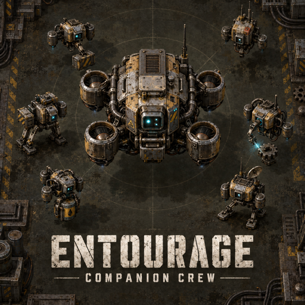

# Entourage

Companion drones for Factorio 2.1.

Every player receives one companion automatically. It stays close, travels with its owner between planets, survives character death, and cannot be mined or killed. Companions park on the previous planet while their owners are on space platforms. There are no drone or companion equipment crafting recipes, fuel requirements, or charging delays.

## Drones

- **Six task managers per companion.** Each manager receives up to 32 nearby tasks and exactly the materials those tasks need. Managers build, upgrade, repair and deconstruct with cyan beams. They return leftovers and salvage before disappearing; full return inventories keep cargo safe in the manager until space becomes available.
- **Six crafters per companion to start.** Independent crafters reserve ingredients, land, and show the item, batch count and progress overhead. They stay at their landing positions while the owner moves. Nearby matching ghosts share batches of up to eight items, including intermediate recipes. The player's handcrafting queue is never used.
- **Custom combat escorts.** A companion launches a squad of up to four small drones from the companion. They use red combat lasers and defend the owner while the crew keeps working. Squad power follows companion upgrades without adding more escorts.

The crew checks for nearby enemies first, skips work without materials or placement space, and favors urgent repairs and recent player actions. Materials come from companion cargo, any chest covered by the owner's current logistics network, the player, or their vehicle. Exact reservations prevent taking an entire stack for one task. Chests marked for removal are excluded from supply and storage.

The work radius defaults to **48 tiles**, configurable from 12 to 96. The main companion normally stays within 12 tiles and recalls within two seconds, or immediately beyond 24. Managers operate on short two-second assignments. Crafters remain planted within 48 tiles; moving farther away or changing planets recalls them after two seconds and refunds their reserved ingredients. Cargo is preserved when return inventories are full.

## Research and settings

Each non-Nauvis planet, including modded planets, receives an expensive companion development technology: 2,000 research units at 60 seconds each. It uses available core science, discovery science and an identifiable planet science pack. Each completed planet improves movement, equipment and crafting, and adds one parallel crafter. Every **two planets grant another permanent companion**. Infinite promethium research grants additional companions.

Mini drone movement defaults to half speed. Change **Mini drone movement speed** in runtime mod settings (0.1 to 2×); it applies immediately to escorts, managers and flying crafters without slowing crafting or task execution.

Crafting starts at **2× recipe speed**, configurable. Infinite crafting research adds 50% of the configured starting speed and one crafter per completed level; planet development adds 25% of starting speed. Bonuses apply to work already in progress.

Normal mode starts with full equipment. Challenge mode retains ordinary research upgrades for speed, combat and equipment. Legacy modes 2 and 3 now behave as normal and challenge, respectively; obsolete forgiving recipes are gone. The old challenge checkbox remains hidden as a compatibility alias. Construction and combat can be toggled separately through shortcuts and configurable hotkeys. Chatter is optional.

## Current limits

Autocrafting supports enabled player-craftable recipes with normal-quality ingredients and one deterministic item output. Fluids, machine-only recipes and probabilistic products require a factory. Broad multiplayer and arbitrary modpack compatibility are not guaranteed by the single-player integration suite.

## Credits and license

Based on Companion Drones by Klonan, kubiix, MrJakobLaich and Maoman, and Gadgetroch's Factorio 2.1 fork. Maintained by Luan. GNU LGPLv3; see COPYING.LESSER and COPYING. The original release history is retained in changelog.txt.

Drone models and animations were made in Blender. Editable sources are in `art/entourage/astra/`. The cover was generated with Imagegen; its prompt is in `art/entourage/logo-prompt.txt`. Art sources are excluded from the game ZIP.

Source: https://github.com/luan/companion-drones-luan
