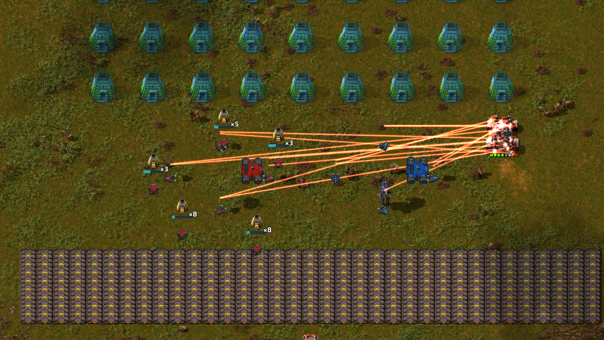
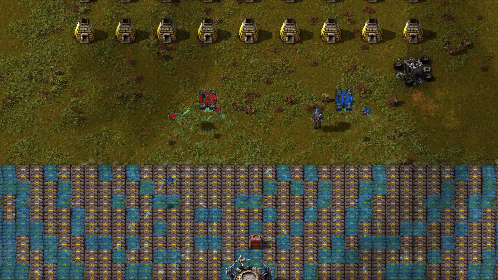

# Entourage 4.0.2 multiplayer checks

Tested on Factorio Space Age 2.1.21 with a dedicated local server and two native clients. The clients used separate identities and write directories. The server stayed unpaused while either client disconnected.

All of these checks passed:

- Each player receives a distinct companion with the correct owner color.
- Both players build and autocraft from one logistics network without duplicate material consumption.
- Construction toggles and player inventories stay separate.
- Changing force keeps inventories and tasks isolated.
- Disconnecting mid-craft releases the task so the remaining player can finish it.
- Full player and companion inventories retain the disconnected crafter's ingredients. Reconnecting and making space returns exactly those ingredients and removes the crafter.
- Disconnect, reconnect, death and respawn preserve the original companion identities.
- Shared planet research adds a companion to each player's fleet.
- Planet travel moves only the traveling player's fleet.
- Space platform travel parks only that player's fleet.
- Saving the server, restarting it and reconnecting both clients preserves both researched fleets without duplicating companions.

Both client logs were checked for desync reports. None appeared. [Test output](multiplayer-4.0.2.log).

The disconnect check failed before the fix: the online player's ghost remained blocked by the offline crafter's claim. The same check passes after recalling the crafter and releasing its claim, including when its cargo cannot fit in the companion.

Run `python3 tests/multiplayer.py /path/to/factorio /path/to/standalone-factorio` to repeat the checks. The standalone client permits a separate local multiplayer identity from the Steam client. Add `--keep-running` to retain the passed session for inspection.

## In-game captures

These captures came from the two-client session after save/reload passed. Both players had completed two planet upgrades. The fixture extends the furnace recipe to four seconds so crafting can be observed. The combat target is a durable test car. Drone models, animations, beams and overlays are the mod's actual assets.

Settings-menu capture remains unfinished: native automated clicks move the cursor onto Settings but do not activate it. These images do not establish that the settings menus were checked.
